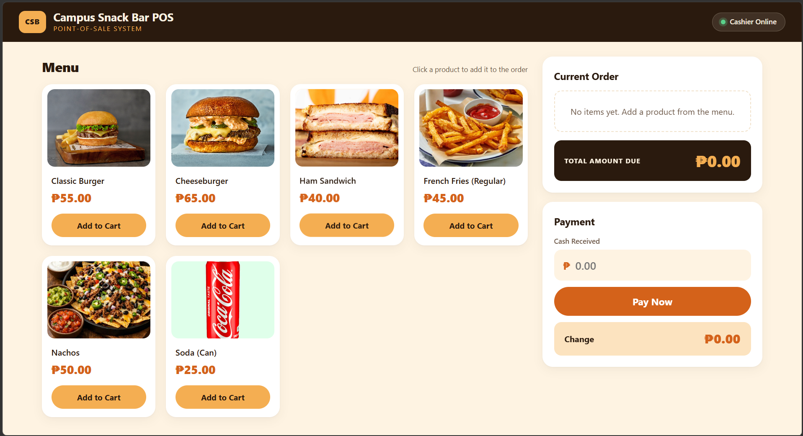
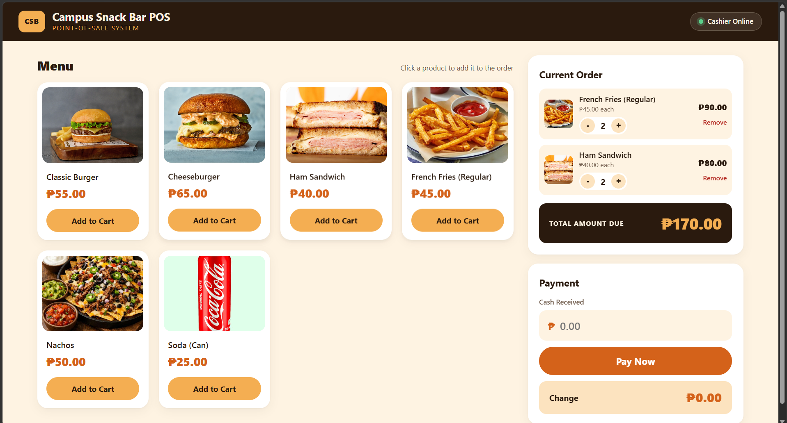
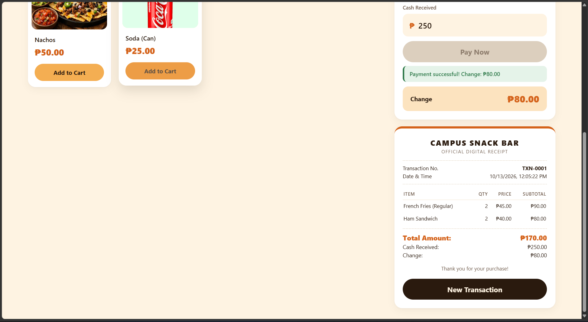

# Campus Snack Bar POS System

A computer-based food ordering and point-of-sale (POS) system for a campus snack bar, built with HTML, CSS, and vanilla JavaScript.

> IT 415 — Application Development and Emerging Technologies
> Midterm Practical Examination · Scenario 4: Campus Snack Bar POS

---

## Project Overview

The Campus Snack Bar POS System lets a cashier take customer orders on a desktop or laptop using a mouse and keyboard. The cashier browses the menu, adds products to the cart, adjusts quantities, accepts cash payment, and generates a digital receipt. The system runs entirely in the browser: products are hard-coded and transaction data is stored in memory, so no database or installation is required.

## Objectives

- Build a functional, user-interactive POS application that follows the required transaction flow: browse products → add to cart → review order → enter payment → validate and compute change → confirm payment → receipt and new transaction.
- Compute subtotals, totals, and change accurately in Philippine pesos (₱).
- Validate cash payments and show clear error and success messages.
- Use AI-assisted development tools responsibly, and track the project with Git and GitHub.

## Technologies Used

| Technology | Purpose |
|---|---|
| HTML5 | Page structure |
| CSS3 | Layout, styling, and responsive design (CSS Grid and Flexbox) |
| JavaScript (vanilla) | Cart logic, calculations, validation, and receipt generation |
| Visual Studio Code | Code editor |
| Git and GitHub | Version control |

No frameworks, external libraries, or database are used.

## Products

| Product | Price |
|---|---|
| Classic Burger | ₱55.00 |
| Cheeseburger | ₱65.00 |
| Ham Sandwich | ₱40.00 |
| French Fries (Regular) | ₱45.00 |
| Nachos | ₱50.00 |
| Soda (Can) | ₱25.00 |

## Main Features

- **Product menu:** six products displayed as cards with photos, names, and prices
- **Add to cart:** add products with on-screen buttons; adding the same product again increases its quantity
- **Quantity controls:** increase (+) or decrease (−) each item; reaching zero removes the item
- **Remove items:** remove any product from the cart
- **Automatic computation:** each item's subtotal and the total amount due update whenever the cart changes
- **Order summary:** shows product, quantity, unit price, and subtotal for every item
- **Cash payment validation:** rejects blank, non-numeric, negative, and insufficient amounts, and blocks payment when the cart is empty
- **Change computation:** Change = Amount Paid − Total Amount
- **Payment confirmation:** success message and change display after a valid payment
- **Digital receipt:** transaction number, date and time, items, quantities, unit prices, subtotals, total, cash received, and change
- **New transaction:** clears the cart, payment, receipt, and messages
- **Responsive layout:** works on desktop, laptop, and smaller screens

## Project Folder Structure

```
├── index.html          # Page structure
├── style.css           # Layout and design
├── script.js           # POS logic: cart, totals, validation, receipt
├── README.md           # Project documentation
├── assets/
│   └── images/         # Product photos
│       ├── classic-burger.jpg
│       ├── cheeseburger.jpg
│       ├── ham-sandwich.jpg
│       ├── french-fries.jpg
│       ├── nachos.jpg
│       └── soda.jpg
└── screenshots/        # Screenshots for documentation
```

## Installation and Running

1. Clone or download this repository:
   ```
   git clone https://github.com/mavsimulation/Balingan-Vergara.git
   ```
   Or click **Code → Download ZIP** on GitHub and extract it.
2. Open the project folder.
3. Open `index.html` in a web browser such as Chrome or Edge.
   - In VS Code, you can also right-click `index.html` and choose **Open with Live Server** (requires the Live Server extension).

No installation, server, or internet connection is required.

## How to Use

1. Click **Add to Cart** on one or more products.
2. Adjust quantities with **+** and **−**, or click **Remove**.
3. Check the **Total Amount Due**.
4. Type the cash received and click **Pay Now** (or press Enter).
5. Review the payment confirmation, change, and digital receipt.
6. Click **New Transaction** to serve the next customer.

## Screenshots

### Product List


### Cart and Order Summary


### Payment Validation


### Payment Confirmation and Receipt


## Developer and Course Information

| | |
|---|---|
| **Developer** | [Cristian Balingan][Will Maverick Vergara] |
| **Program and Section** | BS Information Technology — BSIT 4-H |
| **Course** | IT 415 — Application Development and Emerging Technologies |
| **Instructor** | [Jayson Balbiran] |
| **Institution** | Davao del Norte State College — Institute of Computing |
| **School Year** | First Semester, 2026–2027 |